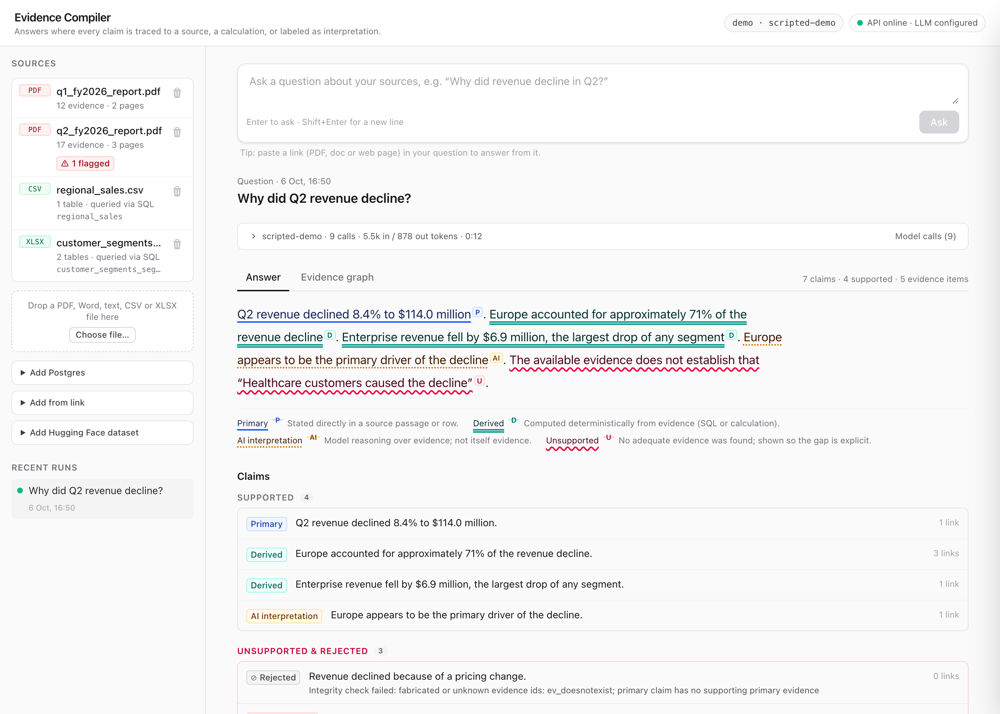
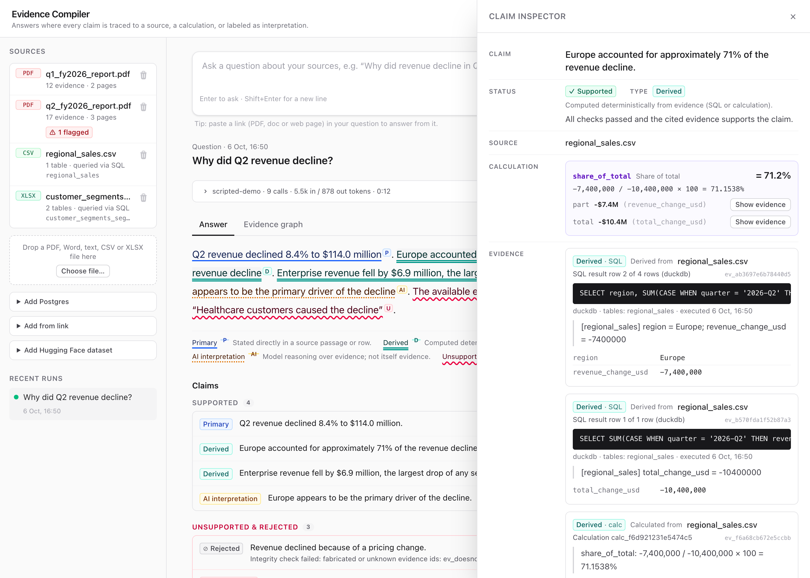
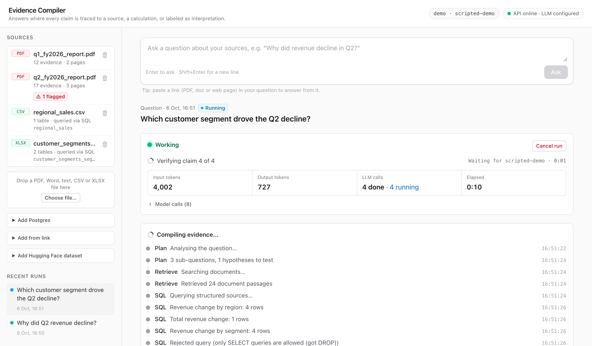

# Evidence Compiler

**Answers you can check.** Ask a question about your documents and data. Every
statement in the answer links to the exact passage, table row, SQL query or
calculation behind it. Anything the evidence doesn't support is marked as
unsupported, not smoothed over.

[](https://github.com/Vamsitallapudi9/Evidence_Compiler/actions/workflows/ci.yml)
[](LICENSE)



## Why

LLM answers mix facts, arithmetic, guesses and made-up details into one fluent
paragraph. Citations help a little, but they point at whole documents, not at the
specific claim. Evidence Compiler splits an answer into **claims** and gives each one a
type:

| Type | Meaning | Backed by |
|---|---|---|
| **Primary** | Stated in a source | A verbatim quote, located to the page |
| **Derived** | Computed from sources | A deterministic calculation or SQL query you can rerun |
| **AI interpretation** | A reasoned conclusion | Labelled as such, with the evidence it rests on |
| **Unsupported** | Not established | Shown explicitly, never cited |

**The core rule: model output can never become evidence.** Only source connectors,
the SQL engine and the calculator can create evidence. The model can only *point*
at it, and code checks every pointer.

## What it does

- **Reads your sources**: PDF, Word, text, CSV, Excel, PostgreSQL, links (web pages,
  Google Docs, arXiv…) and Hugging Face datasets.
- **Checks every claim in code**:
  - the cited evidence exists
  - quotes are verbatim
  - each number matches its evidence
  - each calculation reruns
  - the provenance chain ends at a source
- **Then a second, isolated model check** confirms the evidence actually supports
  the claim.
- **Tests tempting explanations** ("healthcare customers caused it") and reports the
  ones the evidence doesn't back.
- **Shows its work**: a claim inspector, an evidence graph, and a live run monitor
  with token counts, the current step, and stuck detection.

| Claim inspector | Live run monitor |
|---|---|
|  |  |

<sub>Screenshots use the bundled fictional demo data and a scripted model.</sub>

## Quickstart

Requires Python 3.12+, Node 20.19+, and an OpenAI or Anthropic API key. PostgreSQL is optional.

```bash
git clone https://github.com/Vamsitallapudi9/Evidence_Compiler.git && cd Evidence_Compiler
cp .env.example .env          # add your API key
make setup                    # Python venv + frontend packages
make check-llm                # confirms the key and model work (< 1 cent)
make demo-data && make dev    # demo corpus; API :8000, UI http://localhost:5173
```

Add sources in the sidebar, or load the demo with `make load-demo`. Then ask
*"Why did Q2 revenue decline?"*.
Full setup, including Postgres: [docs/getting-started.md](docs/getting-started.md).

## How it works

```
question → plan → retrieve (BM25 + validated read-only SQL) → draft claims
        → code checks → isolated model check → classify → compile answer
```

The model plans, drafts and phrases. Code does everything that can be checked:
calculations, SQL validation, quote matching, number checks, provenance. Details are in
[docs/architecture.md](docs/architecture.md).

## Status

**Phase 1 MVP: working, not production software.** It is a single-user, local tool
with **no authentication**. Run it on your own machine, not on a shared network. The
A/B/C benchmark (RAG vs RAG + citations vs Evidence Compiler) is built, but **no
results are published yet**: they will come from real runs, not estimates. Known gaps
are listed openly in [docs/limitations.md](docs/limitations.md).

## Documentation

| | |
|---|---|
| [Getting started](docs/getting-started.md) | Install, run, troubleshoot |
| [Configuration](docs/configuration.md) | Every setting |
| [Data sources](docs/data-sources.md) | Formats, links, Hugging Face, limits |
| [Architecture](docs/architecture.md) | Pipeline, evidence model, invariants |
| [API](docs/api.md) | REST and live-event endpoints |
| [Security](docs/security.md) | Threat model and mitigations |
| [Evaluation](docs/evaluation.md) | Benchmark design and how to run it |
| [Limitations](docs/limitations.md) | What it does not do (yet) |
| [Roadmap](docs/roadmap.md) | Phase 2 and beyond |
| [Decisions (ADRs)](docs/adr/) | Why things are the way they are |

[Contributing](CONTRIBUTING.md) · [Security policy](SECURITY.md) · [Code of conduct](CODE_OF_CONDUCT.md) · [Changelog](CHANGELOG.md) · [MIT License](LICENSE)
